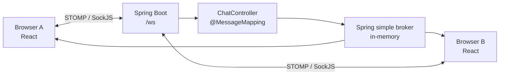

# CHAT-APP

A lightweight **real-time chat demonstration** built with **Java 17, Spring Boot, WebSocket/STOMP, SockJS and React**. Participants can join a public chat room, broadcast messages and exchange user-targeted messages through a simple browser interface.

> **Project status:** Learning/demo application. There is no authentication, durable message storage, automated deployment pipeline, or production-ready private-message authorization. Do not use for sensitive conversations.

## Features

- Public chat room with real-time message broadcasting
- Join notifications when a participant connects
- Username-based conversation list and private-message UI
- WebSocket messaging with STOMP and SockJS fallback
- React client using local in-memory chat state

**Current limitations:** The server uses Spring's in-memory simple message broker. There is no database, account system, chat history, delivery confirmation, presence service, message encryption layer, or reconnection mechanism.

## Technology stack

| Layer | Technology |
| --- | --- |
| Backend | Java 17, Spring Boot 3.1.4, Spring WebSocket, Spring Messaging |
| Messaging | STOMP over SockJS, Spring simple in-memory broker |
| Frontend | React 17, JavaScript, Create React App |
| Client transport | `sockjs-client`, `stompjs` |
| Build tools | Maven Wrapper, npm |
| Tests | Spring Boot test starter; one context-load smoke test |

Versions above reflect the currently committed source code, not recommended latest versions.

## Architecture



The client connects to the Spring endpoint at `/ws`. Public messages are sent to `/app/message` and published to `/chatroom/public`. Private messages are sent to `/app/private-message` and the server uses `SimpMessagingTemplate.convertAndSendToUser` for user-directed delivery.

> **Private messaging caveat:** The UI currently subscribes to a username-specific path, while the backend uses Spring's user-destination API. Without a verified STOMP principal and a matching user-destination subscription scheme, private-message routing and isolation are not guaranteed. Treat private messaging as an intended demo feature requiring fixes and tests, not a secure implemented capability.

### Messaging destinations (current source)

| Purpose | Destination |
| --- | --- |
| SockJS/WebSocket handshake | `/ws` |
| Send public message | `/app/message` |
| Receive public messages | `/chatroom/public` |
| Send private message | `/app/private-message` |
| Private client subscription (current) | `/user/{username}/private` |
| Backend private target | `convertAndSendToUser(receiverName, "/private", message)` |

The private subscription/identity design should be corrected before claiming reliable private messaging. A future authenticated STOMP client would commonly subscribe to `/user/private`, with the server resolving the authenticated user.

### Message format

```json
{
  "senderName": "alice",
  "receiverName": "bob",
  "message": "Hello!",
  "date": "2026-11-07",
  "status": "MESSAGE"
}
```

The model defines `senderName`, `receiverName`, `message`, and `date` as strings, and `status` as one of `JOIN`, `MESSAGE`, or `LEAVE`. The client does not populate every field for every event, and the server currently does not validate this payload.

## Getting started

### Requirements

- JDK 17
- npm and a Node.js version compatible with the committed Create React App toolchain
- Internet access for first-time dependency installation

### 1. Clone the project

```bash
git clone https://github.com/Iyedchaabane/CHAT-APP.git
cd CHAT-APP
```

### 2. Start the backend

In one terminal:

```bash
cd Chat-App-server
./mvnw spring-boot:run
```

On Windows use `mvnw.cmd spring-boot:run`. The default Spring Boot HTTP port is **8080**. No database setup is required.

### 3. Start the frontend

In a second terminal, from the repository root:

```bash
cd react-client
npm ci
npm start
```

Open **http://localhost:3000**. The frontend currently connects to **http://localhost:8080/ws** using a hardcoded URL in `ChatRoom.js`. To use a different backend host or port, change that URL in the current implementation; making it environment-configurable is a recommended improvement.

### 4. Try the demo

1. Open the app in two separate browser tabs.
2. Enter a distinct username in each tab and select **connect**.
3. Send a message to the public room.
4. A username may appear in the sidebar after its join event is received.
5. Private conversations appear in the UI, but their delivery is not verified and should not be used to exchange sensitive content.

## Run tests and build locally

Backend test:

```bash
cd Chat-App-server
./mvnw test
```

Backend package:

```bash
./mvnw package
```

Frontend production bundle:

```bash
cd react-client
npm ci
npm run build
```

Frontend test runner:

```bash
CI=true npm test -- --watchAll=false
```

The current repository includes only a backend context-load test. It does not yet include message-routing unit/integration tests or frontend component tests. These commands are provided for local execution; they have **not** been verified in CI.

## Repository structure

```text
CHAT-APP/
├── Chat-App-server/
│   ├── pom.xml
│   ├── mvnw
│   └── src/
│       ├── main/java/com/example/Chat/App/
│       │   ├── ChatAppApplication.java
│       │   ├── config/WebSocketConfig.java
│       │   ├── controller/ChatController.java
│       │   └── model/{Message.java,Status.java}
│       └── test/java/com/example/Chat/App/
│           └── ChatAppApplicationTests.java
├── react-client/
│   ├── package.json
│   ├── public/
│   └── src/
│       ├── App.js
│       ├── components/ChatRoom.js
│       └── index.css
└── README.md
```

## Security and reliability notes

This repository is intentionally small, but several areas need attention before a public deployment:

- **Identity and authorization:** The backend accepts names supplied by clients without verifying who sent the message. Authenticate WebSocket sessions, use trusted principals, and restrict which destinations participants can send or subscribe to.
- **WebSocket origins:** `WebSocketConfig` currently uses `setAllowedOriginPatterns("*")`. Restrict origins in non-local environments.
- **Input validation:** Validate required fields, status transitions and message length; avoid trusting user-provided sender identities or timestamps.
- **Private routing:** Align `convertAndSendToUser` with authenticated user destinations and test sender/receiver isolation end-to-end.
- **Client lifecycle:** Replace the module-global STOMP client with instance-scoped connection management, cleanup, reconnection and subscription handling.
- **React state:** Replace direct mutations to `Map` and message arrays with immutable, functional state updates.
- **Operational limits:** Introduce sensible message-size, connection and rate limits, and avoid logging private message content.
- **Persistence:** The current broker and frontend arrays are ephemeral. Add storage only when message history is a product requirement.

## Engineering roadmap

These are **proposed improvements, not implemented features**.

| Priority | Improvement | Definition of done |
| --- | --- | --- |
| P0 | Fix private-message identity and routing | Authenticated sessions; unauthorized destinations rejected; two-user isolation tested |
| P0 | Validate messages and limit abuse | Invalid payloads and oversized messages rejected with tests |
| P1 | WebSocket and React tests | Public broadcast, private delivery, join handling, unmount/reconnect scenarios covered |
| P1 | Fix state and connection lifecycle | No in-place state mutation; subscriptions disposed; stale event handlers addressed |
| P1 | GitHub Actions CI | Backend tests, frontend tests and builds run on pushes and PRs |
| P1 | Docker / Compose | Reproducible backend and frontend containers with configuration externalized |
| P2 | Upgrade dependencies | Supported Spring Boot/React toolchain; compatibility and security tests passing |
| P2 | Developer quality tooling | Formatting, lint, dependency scanning, test coverage reports |
| P3 | Optional durable history | Database and migration strategy if the product needs history |
| P3 | Optional multi-instance scaling | Shared external broker only when scaling beyond one backend instance |

Suggested incremental delivery: first correct and test messaging, then add CI quality gates, then containerize the verified application. Avoid introducing Kafka, microservices, or a database solely for architectural complexity.

## Contributing

Open an issue with reproduction steps before larger changes. Keep pull requests focused and include tests for behavior changes. Run the backend and frontend checks listed above before requesting a review.

## Project scope

This application demonstrates a browser-to-server real-time messaging flow. It should be presented as a **WebSocket chat prototype**, not as a production-secure messaging platform.
